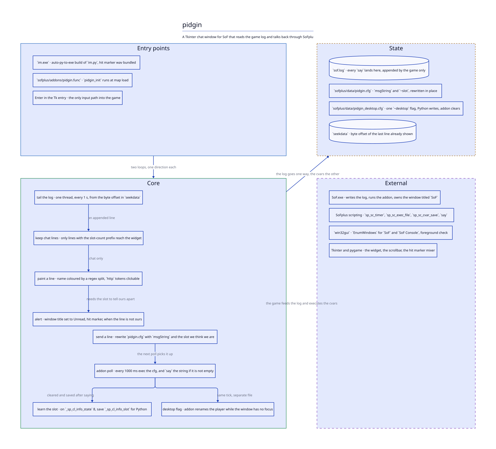

# pidgin

A proof-of-concept chat window for Soldier of Fortune: a Tkinter app tails the game's own `sof.log` to show incoming chat, and writes SoFplus cvar files that a companion addon polls and speaks with `say`.

Read it left to right:

- **The transport is the game log.** There is no socket and no IPC for incoming messages: SoFplus `say` puts the line in `sof.log`, and `im.py` reads that file in a thread every second starting from a byte offset stored in `seekdata`. Anything the game prints with a `: [n]` slot prefix is treated as chat and painted into the widget, with the name coloured by a regex split and any `http` token made clickable.
- **Outgoing messages go the other way, through a cvar file.** Pressing Enter rewrites `sofplus/data/pidgin.cfg` with `msgString` and `~slot`; the addon's 1000 ms timer `sp_sc_exec_file`s that file, and if `msgString` is not empty it runs `say`, clears the cvar and saves the file again. Both sides open the file `r+`, blank the first three lines with spaces, `seek(0)` and write — there is no atomic replace, so the addon can read the file mid-write and see a half line.
- **Tailing by byte offset has no recovery path.** `seekdata` is written once at startup with the current size of `sof.log`, so everything already in the log is skipped by design. If the log is truncated or rotated (a restart writing a fresh file, a clean-up script) the stored offset points past the start and every later read seeks into the middle of a line or fails outright. Reads are decoded as `latin-1`, which is why the README admits SoF1 characters are not handled.
- **The window guesses which messages are its own by scraping the config.** `mySlot` starts as a bare `@` and is overwritten on each Enter with the slot value parsed out of `pidgin.cfg` — the same file it just wrote. That is why the addon has `sof_pidgin_set_slot`: when `_sp_cl_info_state` becomes 8 it stores `_sp_cl_info_slot`, so the file always carries the slot the player is really speaking from. If the file is malformed, the parse throws inside the key handler.
- **"On the desktop" is announced by renaming the player.** While `SoF Console` does not have focus, Python writes `~desktop 1`; the addon then sets your name to `@Desktop` and restores the previous one (`desktop_name_orig`, tracked by `sof_pidgin_set_name`) when the flag goes back to 0. That name is visible to everyone on the server, so `set p_desk_notify "0"` at the top of the addon is the off switch. `pidgin_init` also carries a fallback name for the case where SoF was quit while minimised and the config still says `@Desktop`.

Diagram source: [`docs/system.d2`](docs/system.d2) · renderer: [`scripts/render-diagram.sh`](scripts/render-diagram.sh).
